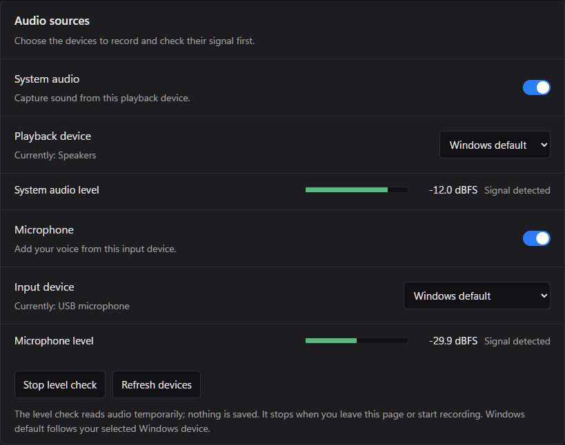

# WinShotX English

A focused Windows screenshot and on-demand video recorder, forked from [Mun1to/winshotx](https://github.com/Mun1to/winshotx). Original authorship and the MIT license are preserved.

## Changes in 0.4.0

- English-only interface, with a new sidebar and settings pages for screenshots, recording, and preferences.
- Native Windows tray menu replaces the separate WebView menu that could appear as a blank white rectangle.
- Screenshots and MP4 video only in the capture UI. GIF selection and its keyboard shortcut are removed.
- Continuous recording, the replay buffer, and the replay shortcut are removed. Recording starts only on request.
- Capture quality, bitrate, and frame rate controls up to a 120 fps target, plus configurable FFmpeg encoders, CRF/CQ quality, presets, NVIDIA GPU index, and custom output arguments.
- Playback-device and microphone selection, with an explicit live peak-level check before recording.
- Separate application identity, settings, temporary storage, and startup registry entry. Upstream automatic updates are disabled for this fork.




## Capture

Left-click the tray icon to open the app. Right-click for screenshots, start/stop recording, the capture folder, settings, or quit.

Default shortcuts:

| Action | Shortcut |
| --- | --- |
| Screenshot | Print Screen |
| Start / stop video | Shift+Print Screen |

Change shortcuts in Settings by clicking a shortcut and pressing a combination; Print Screen may be used on its own. When a shortcut uses Print Screen, WinShotX turns off the Windows setting that gives that key to the Snipping Tool (`PrintScreenKeyForSnippingEnabled`). Screenshot and recording shortcuts each have an independent default selection: Rectangle, Window, or Full screen.

There is no toolbar after selecting: releasing the mouse copies a screenshot to the clipboard (and, if enabled, also saves it to the screenshot folder) or starts the recording. Screenshots default to `F:\Pictures\Screenshots` and videos to `F:\Videos\Captures`; both can be changed under Preferences.

## Encoding

Recording requires FFmpeg. Capture targets are 15, 24, 25, 30, 50, 60, 90, or 120 fps.

In **Settings → Recording → Encoding**, enter the full path to `ffmpeg.exe`, or use `ffmpeg` for PATH lookup. SVP 4's bundled executable is detected automatically when present. The app checks the selected executable and lists the encoders in that build; encoders not compiled into it are disabled in the selector.

**Use balanced settings** selects H.264/x264, the `veryfast` preset, and constant-quality CRF 20. Lower values increase quality and file size. NVENC uses CQ, Quick Sync uses global quality, and AMF uses QP. A separate target-bitrate mode is available. The CRF/CQ slider and numeric field stay synchronized. Settings saved by older builds with the removed built-in engine are migrated to x264 `veryfast`.

| Encoder | Hardware |
| --- | --- |
| H.264 / HEVC | CPU: x264 / x265 |
| AV1 | CPU: libaom or SVT-AV1, when included in the FFmpeg build |
| H.264 / HEVC / AV1 | NVIDIA NVENC |
| H.264 / HEVC | Intel Quick Sync |
| H.264 / HEVC | AMD AMF |

Encoder support depends on your FFmpeg build, GPU, and driver. NVIDIA device indices start at 0; blank means automatic selection. Other hardware encoders select their default device, with further options available through advanced arguments.

Recordings are encoded live. Raw BGRA frames and 16-bit PCM audio are streamed to FFmpeg over loopback sockets; no frame cache or intermediate file is written. FFmpeg writes a fragmented MP4 (`empty_moov`, about one fragment per second) straight into the save folder as `<name>.recording.mp4`. Stopping finalizes the file and renames it to `<name>.mp4`. If the app or FFmpeg is interrupted, the `.recording.mp4` file stays in the save folder and plays up to the last completed fragment. Discarding a recording deletes only its own partial file.

Video and audio share one clock that excludes paused time. A static source repeats its last frame at the output rate. If the encoder falls more than two seconds behind, recording stops with an error and the fragments written so far are kept; choose a faster preset, a hardware encoder, or a lower frame rate.

**Recording presets** store a frame rate plus all encoding options. Pick one under Settings → Recording → Presets or in the capture bar at the top of the screen before recording; save the current settings under a name to create or replace one. Below the encoding options the settings show the exact FFmpeg command recordings run, generated from those settings; any LLM or guide can help you write extra arguments for it, which you then save as a preset.

Use **Test encoder** to encode a half-second generated 1280 × 720 picture and tone at the selected frame rate. It checks the actual encoder, preset, quality, device index, and advanced arguments without reading your screen or audio devices. Results clear when relevant settings change. Tests time out after 20 seconds. Passing checks compatibility; it does not promise sustained full-resolution capture performance.

120 fps is a target, not a guarantee of 120 distinct source frames per second. Windows Graphics Capture delivers frames according to source/compositor updates and system performance; see the [capture backend's frame-update behavior](https://docs.rs/windows-capture/latest/windows_capture/settings/enum.MinimumUpdateIntervalSettings.html). The recording bar reports measured capture fps. Cadence tests cover 144 Hz and 240 Hz sources, and a bounded raw-frame queue prevents an encoder or disk backlog from consuming unbounded memory.

The encoder preset is a drop-down of the values the selected encoder accepts. Use a fast preset for live recording. Defaults are `veryfast` for x264/x265/Quick Sync, `p4` for NVENC, and the encoder default for AMF/software AV1.

Advanced output arguments are a JSON array of strings, for example:

```json
["-g", "120", "-bf", "2"]
```

To override quality explicitly:

```json
["-crf", "18", "-preset", "slow"]
```

Arguments are passed directly to FFmpeg without a shell, after generated codec options and before the managed destination path. They can override codec options; inputs, audio selection, output naming, and the fragmented-MP4 muxing flags remain managed by the app and are always applied last. To re-encode a finished recording, run FFmpeg yourself, for example:

```powershell
ffmpeg -i "capture.mp4" -c:v libx265 -crf 18 -preset slow -c:a copy "output.mp4"
```

Missing FFmpeg and unsupported encoders produce errors rather than silently selecting another encoder.

## Audio setup

Under **Recording → Audio sources**, enable system audio and/or microphone and choose their playback/input devices. Windows default resolves the current default endpoint when recording starts; choose a named endpoint to keep the source fixed.

Use **Check levels** to see the actual peak signal and dBFS before recording. Silence, very quiet input, near-clipping peaks, and device errors are distinguished. The check keeps samples in memory only and saves no audio files. It stops on page exit, settings-window close, recording start, or after three seconds without frontend polling.

Recording uses the same selected endpoints. A missing or inaccessible requested source is reported instead of silently falling back to a different device or omitting the microphone. Adjust device gain/volume in Windows sound settings as needed.

## Build

Requires Windows 10/11, WebView2, Node.js, Rust, and the Visual Studio C++ build tools / Windows SDK.

```powershell
npx --yes pnpm@10 install --frozen-lockfile
npm run build
npm test
npm run tauri -- build --no-bundle
```

The executable is `src-tauri/target/release/winshotx.exe`. To create an unsigned NSIS installer, omit `--no-bundle`. Signing and upstream update infrastructure are not configured for this fork.

For development:

```powershell
npm run tauri -- dev
```

The frontend development URL is `http://localhost:1421/`; native capture requires the Tauri application.
