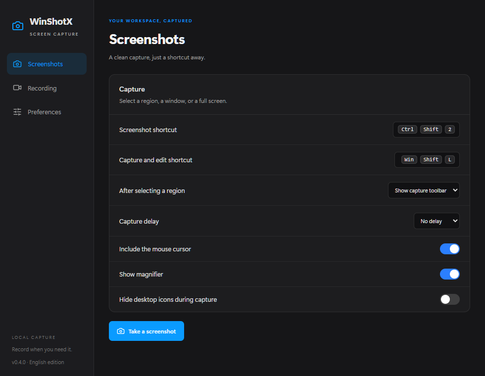
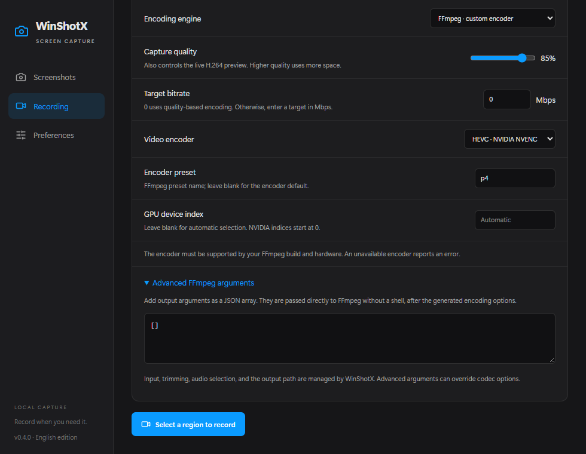

# WinShotX English

A focused Windows screenshot and on-demand video recorder, forked from [Mun1to/winshotx](https://github.com/Mun1to/winshotx). Original authorship and the MIT license are preserved.

## Changes in 0.4.0

- English-only interface, with a new sidebar and settings pages for screenshots, recording, and preferences.
- Native Windows tray menu replaces the separate WebView menu that could appear as a blank white rectangle.
- Screenshots and MP4 video only in the capture UI. GIF selection and its keyboard shortcut are removed.
- Continuous recording, the replay buffer, and the replay shortcut are removed. Recording starts only on request.
- Capture quality, bitrate, and frame rate controls, plus configurable FFmpeg encoders, presets, NVIDIA GPU index, and custom output arguments.
- Separate application identity, settings, temporary storage, and startup registry entry. Upstream automatic updates are disabled for this fork.





## Capture

Left-click the tray icon to select a screenshot region. Right-click for screenshots, start/stop recording, the capture folder, settings, or quit.

Default shortcuts:

| Action | Shortcut |
| --- | --- |
| Screenshot | Ctrl+Shift+2 |
| Start / stop video | Ctrl+Shift+5 |
| Capture and edit | Win+Shift+L |

Change shortcuts in Settings. Screenshots can be copied, saved, pinned, or edited. The editor supports PNG/JPG images and MP4 video, trimming, cropping, and annotations.

## Encoding

Windows Media Foundation H.264 is the default and needs no extra installation. Capture rates are 15, 24, 25, 30, 50, or 60 fps. Quality ranges from 10 to 100. A target bitrate of 0 uses quality-based encoding; a positive value specifies Mbps.

For additional encoders, install FFmpeg, add it to PATH, restart the app, and choose **Settings → Recording → Encoding engine → FFmpeg**.

| Encoder | Hardware |
| --- | --- |
| H.264 / HEVC | CPU: x264 / x265 |
| AV1 | CPU: SVT-AV1 |
| H.264 / HEVC / AV1 | NVIDIA NVENC |
| H.264 / HEVC | Intel Quick Sync |
| H.264 / HEVC | AMD AMF |

Encoder support depends on your FFmpeg build, GPU, and driver. NVIDIA device indices start at 0; blank means automatic selection. Other hardware encoders select their default device, with further options available through advanced arguments.

FFmpeg options apply to the **final MP4 export**, including direct saves when the editor is disabled. Live recording and editor previews use native H.264. The final export is generated from the cached frames, with edits and audio applied, and then transcoded using FFmpeg. This is not a raw or lossless recording pipeline. Native quality and bitrate also affect the live preview; final quality can be adjusted in the editor.

The preset field takes an FFmpeg encoder preset name. Defaults are `medium` for x264/x265/Quick Sync, `p4` for NVENC, and the encoder default for AMF/SVT-AV1.

Advanced output arguments are a JSON array of strings, for example:

```json
["-g", "120", "-bf", "2"]
```

To override quality explicitly:

```json
["-crf", "18", "-preset", "slow"]
```

Arguments are passed directly to FFmpeg without a shell, after generated codec options and before the managed destination path. They can override encoding options; input selection, editing, audio selection, and output naming remain managed by the app. For a completely independent command, export a video and run FFmpeg yourself, for example:

```powershell
ffmpeg -i "capture.mp4" -c:v libx265 -crf 18 -preset slow -c:a copy "output.mp4"
```

Missing FFmpeg and unsupported encoders produce errors rather than silently selecting another encoder.

## Build

Requires Windows 10/11, WebView2, Node.js, Rust, and the Visual Studio C++ build tools / Windows SDK.

```powershell
npx --yes pnpm@10 install --frozen-lockfile
npm run build
npm test
npm run tauri -- build --no-bundle
```

The executable is `src-tauri/target/release/winshotx.exe`. To create an unsigned NSIS installer, omit `--no-bundle`. Signing and upstream update infrastructure are not configured for this fork.

For development:

```powershell
npm run tauri -- dev
```

The frontend development URL is `http://localhost:1421/`; native capture requires the Tauri application.
