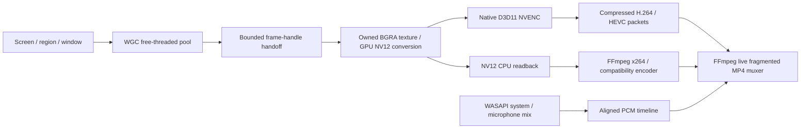

# OBS recording design applied to Snapframe

Reference checkout: `C:\Users\Benedikt Jung\Code\obs-studio`.
Inspected commit: `7a25c3fd8b5eb87c2d2e0606cae36e32014bc6fa`.

The sibling checkout is a clean shallow clone of the official OBS repository, kept outside
Snapframe's source tree for future inspection. To reproduce this audit from the Snapframe
repository root without changing either checkout:

```powershell
git -C ..\obs-studio rev-parse HEAD
git -C ..\obs-studio grep -n video_sleep 7a25c3fd8b5eb87c2d2e0606cae36e32014bc6fa -- libobs/obs-video.c
git -C ..\obs-studio show 7a25c3fd8b5eb87c2d2e0606cae36e32014bc6fa:plugins/obs-nvenc/nvenc-d3d11.c
```

Use the pinned revision when comparing these notes; updating the checkout does not update
the recorded source audit or prove behavior in a newer OBS release.

## Assessment

OBS is a strong practical baseline for Windows recording. Its key advantage here is keeping
large video surfaces on the GPU through capture, composition and hardware encoding. Its CPU
encoder branch also benefits from GPU color conversion before downloading frames. There is
no evidence from this source audit that rewriting its general architecture would improve
reliability. Workload-specific simplifications are more promising than a new capture model.

This is an architectural assessment, not a comparative OBS benchmark or a claim that OBS
cannot miss frames under GPU/encoder overload.

## What OBS actually does

| Stage | Source in the checkout | Relevant behavior |
|---|---|---|
| Display backend choice | `plugins/win-capture/duplicator-monitor-capture.c`, `choose_method` | Auto favors DXGI duplication; WGC handles unavailable output indices and some multi-adapter laptop cases. |
| Desktop capture | `libobs-d3d11/d3d11-duplicator.cpp`, `gs_duplicator_update_frame` | Nonblocking `AcquireNextFrame(0)`, GPU-owned copy, `ReleaseFrame`; a timeout retains the previous image. Access loss triggers recovery. |
| Window/WGC capture | `libobs-winrt/winrt-capture.cpp`, `on_frame_arrived` | Copies/crops into a reusable GPU texture. This revision uses a two-buffer dispatcher-backed pool, not `CreateFreeThreaded`. |
| Output clock | `libobs/obs-video.c`, `video_sleep` | Absolute monotonic deadlines, missed-period accounting and timestamps independent of capture arrival. |
| Windows wait | `libobs/util/platform-windows.c`, `os_sleepto_ns` | Coarse sleep followed by QPC polling/spinning, with a 1 ms timer-period request. |
| Color conversion | `libobs/obs-video.c`, `render_convert_texture` | GPU conversion to NV12/P010/planar surfaces with explicit color matrices. |
| Texture queue | `libobs/obs-video.c`, `queue_frame` | Bounded available/ready pools, texture swapping in the common path, keyed-mutex synchronization. Pool exhaustion repeats a previous image rather than growing RAM indefinitely. |
| Encoder worker | `libobs/obs-video-gpu-encode.c` | Separate encoding thread; timestamped textures, audio startup coordination and pause offsets. |
| NVENC input | `plugins/obs-nvenc/nvenc-d3d11.c` | Shared D3D11 textures, keyed mutexes, pooled NV12/P010 encoder inputs registered once with NVENC. Some GPU-to-GPU copies remain. |
| NVENC output | `plugins/obs-nvenc/nvenc.c` | A ring sized for B-frames/lookahead. This revision uses synchronous NVENC and blocking bitstream locks on the encoder worker, away from rendering. |
| CPU output | `libobs/obs-video.c`, `stage_output_texture` / `download_frame` | GPU-converted surfaces are staged through a two-texture ring before CPU access. |
| CPU encoder | `plugins/obs-x264/obs-x264.c` | x264 accepts YUV planes/NV12 and timestamps; its default speed preset is `veryfast`. |

Calling this "zero-copy" would be inaccurate. The useful invariant is **no full-image CPU
readback on the hardware path**, rather than no GPU copies anywhere.

## Adaptation implemented



Both screen and window capture use WGC. Snapframe deliberately omits OBS's automatic DXGI /
WGC backend selector: one source, no scene compositor, no preview, one recording output.
The callback hands off a frame handle through a bounded queue of two. A worker owns its
D3D11 immediate context, copies the newest image into an owned BGRA input and closes the
capture frame promptly. The three-buffer WGC pool can continue delivering independently.
An explicit `MinUpdateInterval = 0` requests source-driven updates; the app owns output timing.

### Native NVIDIA branch

`record/nvenc.rs` dynamically loads `nvEncodeAPI64.dll` from System32. The same D3D11 device
owns capture, the BT.709 NV12 conversion surface and the NVENC registration. The converted
surface is registered once, mapped for each submission, and reused only after bitstream
completion and unmapping. There is no raw-image CPU readback, CPU RGB conversion, CUDA
installation, build-time binding generator or NVIDIA import-library requirement. Only
compressed H.264/HEVC crosses CPU memory; an in-memory MPEG-TS bridge supplies explicit
PTS/PCR to the local video socket. The bridge creates no recording sidecar. FFmpeg uses
`-c:v copy` and combines it with AAC audio into the live MP4; it does not encode this video.
Vendored encoder ABI bindings retain their MIT notices in `record/nvenc_sys/`.

The worker samples the newest owned image at absolute `Instant` deadlines. Each deadline
advances from the previous deadline, so conversion and sleep time do not accumulate drift.
A scoped 1 ms Windows timer request and short final spin follow the OBS waiting principle.
A static source reuses the last GPU image. An encoder delay exceeding two seconds fails with
an actionable error rather than accumulating an unlimited recording backlog.

B-frames follow `plugins/obs-nvenc/nvenc.c`: 2 B-frames when `NV_ENC_CAPS_NUM_MAX_BFRAMES`
allows, B-frame references disabled, no lookahead, a ring of `max(4, 4 × frameIntervalP)`
registered NV12 textures and bitstreams, packets collected once `ring − 1` pictures are
queued, PTS from `outputTimeStamp`, DTS from a FIFO of submitted timestamps minus the
B-frame count, and an end-of-stream picture plus full drain on Stop. Each frame is copied
from the converter's surface into its ring slot. The MPEG-TS bridge writes PTS and DTS with a
one-second offset (FFmpeg removes each input's start time, so A/V alignment is unchanged:
audio 4.7 ms after picture as played, before and after).

The remaining simplification relative to OBS is **synchronous submission and collection on
the recording worker** instead of a separate encoder thread, and no shared-handle/keyed-mutex
device. Async NVENC was tried but this RTX 4080 driver does not report
`NV_ENC_CAPS_ASYNC_ENCODE_SUPPORT`; submit calls measured 0.15–0.4 ms anyway.

B-frames are limited to recordings below 1440p60's pixel rate. With 2 (or 1) B-frames, each
P-frame submission makes NVENC encode the held pictures in one burst, and at 1440p60/4K60
Windows then missed delivering the next capture frame: 1–2 (1440p60) and 3–10 (4K60) repeated
visible frames per 240, always on the second B-frame, versus 0 without B-frames. 1080p60
measured 0/1740 in three 30-second runs with B-frames.

Native support is intentionally exact: H.264/HEVC NVENC, P1-P7, default adapter, constant
quality or target bitrate, and no custom output arguments. Quality maps to NVENC VBR target
quality; target bitrate maps to CBR. Color metadata is limited-range BT.709; the keyframe
interval is two seconds. Existing presets are preserved. Explicit GPU selection, custom
arguments, other preset spellings and other encoders use the NV12 compatibility path so
those requests are honored instead of silently discarded. Native initialization failures
are reported rather than silently changing encoder or quality.

### CPU and compatibility branch

D3D11 VideoProcessor converts BGRA into limited-range BT.709 NV12 with automatic enhancement
processing disabled. NV12 uses 1.5 bytes/pixel versus BGRA's 4: a packed 3840x2160 frame is
12,441,600 bytes instead of 33,177,600. At 60 FPS, one transfer is approximately 0.746 GB/s
instead of 1.991 GB/s, excluding padding and extra copies. x264 consumes NV12 directly;
encoders requiring planar YUV may perform a layout conversion in FFmpeg.

The worker reuses a conversion surface and CPU-readable staging texture, packs padded rows
into recycled buffers, and hands them to independent video/audio writers. This version uses
one immediate readback surface; OBS's two-surface delayed staging is a profiling candidate.
Readback and encoding remain outside the delivery callback. CPU output uses a shared
active-time clock, repeats the previous image while the source is static, and excludes pauses.
Without NVENC, automatic encoding (`encode/auto.rs`) picks the x264 speed from size, fps,
quality level, CPU threads and load, e.g. `medium` at 1080p30 and `fast` at 1080p60 (Medium).
Preflight (`encode/preflight.rs`) refuses CPU presets too
slow for the pixel rate, e.g. x264 slower than `veryfast` at 4K60.

### Lifetime, audio and storage

Audio is captured by WASAPI independently of video. The video epoch is the first actual
captured frame, not process launch or the first encoded packet. Audio preceding that instant
is trimmed; packet jitter is buffered before silence filling. System audio and microphone
mix into one PCM track, then FFmpeg encodes AAC. Video starts immediately; withholding it
for audio startup previously overflowed a small capture queue.

The destination exists and grows during recording as `<name>.recording.mp4`. Fragmented MP4
writes recoverable fragments continuously; Stop drains input and renames to `<name>.mp4`.
Discard kills the child and deletes the owned partial. Failed/interrupted output retains
completed fragments. No raw-frame spool or full recording re-encode occurs at Stop.
FFmpeg belongs to a kill-on-close Windows job, preventing an orphan after an app crash.

Capture close/recreation is synchronized with in-flight callbacks. A process-lifetime
implicit COM MTA prevents native WGC code unloading while queued callbacks still execute;
session textures and frame buffers are released on Stop. A source close terminates recording.
Output dimensions remain fixed and even; a smaller resized window is padded black and a
larger one is cropped. Native GPU Pause is currently unavailable; the toolbar has Stop and
Discard. The CPU recording service retains pause/resume support.

### Source map

| Snapframe file | Responsibility |
|---|---|
| `record/capture_session.rs` | WGC lifecycle, callback handoff, native GPU sampling clock, shutdown/recreation |
| `record/nv12.rs` | D3D11 crop/pad, BT.709 conversion, optional NV12 CPU download |
| `record/nvenc.rs` | Dynamic NVENC API, preset/rate control, registered texture, bitstream lifetime |
| `record/win.rs` | Screen/window selection, crop coordinates, CPU delivery limiter and recycled buffers |
| `recorder.rs` | Route selection, audio alignment, bounded writer queues, Stop/Discard and events |
| `record/stream_encoder.rs` | Raw NV12 or compressed-stream input, independent sockets, FFmpeg muxing and recovery |
| `platform/child_job.rs` | Recording child lifetime tied to the app |
| `record/validation.rs` | Native GPU-presented animation and visible frame IDs for decoded-motion checks |

### Approach rejected during validation

FFmpeg 7.1 `ddagrab` kept images on D3D11 and produced nominal 60 FPS files, but a decoded
visible-ID test found many repeated motion frames on this 120 Hz desktop. Increasing source
FPS or restoring output rate metadata did not reliably remove them. That capture route was
removed. The native worker owns the sampling clock and uses the most recent captured image.

## Improvements that are worth considering later

1. **Fuse crop/scale/color conversion where useful.** A single-source recorder can omit general
   scene rendering. Keep safe texture ownership; holding capture-pool frames indefinitely can
   starve delivery. OBS already swaps textures in its common queue path, so swapping alone is
   not a novel improvement.
2. **High-resolution waitable timers.** A modern Windows-only clock can test event-based waits
   with a short optional final spin against OBS's sleep/spin strategy. This may lower CPU and
   power use; it is not a proven cadence improvement until tail jitter is measured under load.
3. **Asynchronous NVENC completion.** Windows supports completion events and a drain thread.
   This could improve overlap/tail latency versus synchronous output
   collection, but adds lifecycle complexity. A bounded texture pool with an output worker
   is the next step if measurements under GPU load show the single-surface path falling behind.
4. **Budget buffers by bytes and encoder delay.** NV12/P010 pools should account for B-frames
   and lookahead. Fewer buffers save memory but can lower throughput; huge queues hide lag.
5. **More actionable diagnostics.** Separate source inactivity, missed render deadlines,
   encoder backlog, duplicate output and disk trouble. Output FPS alone cannot prove fresh
   motion. A static image is a legitimate repeated frame.
6. **Delayed CPU readback.** Profile a two-surface staging ring like OBS's before changing
   the verified 1080p CPU path. It can overlap a copy with CPU access to the previous surface;
   it cannot compensate for an encoder that is slower than the requested output rate.

The big gain is removing CPU round trips, not increasing FIFO sizes, switching pipe types,
forcing real-time process priority, or silently changing a user's quality preset. D3D12,
dirty-rectangle schemes and eliminating every GPU copy need measured evidence first.

## Primary references

- [Pinned OBS video pipeline](https://github.com/obsproject/obs-studio/blob/7a25c3fd8b5eb87c2d2e0606cae36e32014bc6fa/libobs/obs-video.c)
- [Pinned OBS NVENC D3D11 implementation](https://github.com/obsproject/obs-studio/blob/7a25c3fd8b5eb87c2d2e0606cae36e32014bc6fa/plugins/obs-nvenc/nvenc-d3d11.c)
- [OBS performance guidance](https://obsproject.com/kb/encoding-performance-troubleshooting)
- [NVIDIA NVENC programming guide](https://docs.nvidia.com/video-technologies/video-codec-sdk/13.0/nvenc-video-encoder-api-prog-guide/index.html)
- [FFmpeg Desktop Duplication source](https://ffmpeg.org/ffmpeg-filters.html#ddagrab)
- [Microsoft high-resolution waitable timers](https://learn.microsoft.com/en-us/windows/win32/api/synchapi/nf-synchapi-createwaitabletimerexw)

OBS's code carries GPL licensing. This implementation uses the architecture and documented
Windows/NVIDIA/FFmpeg APIs; it does not include copied OBS source or change Snapframe's MIT license.
